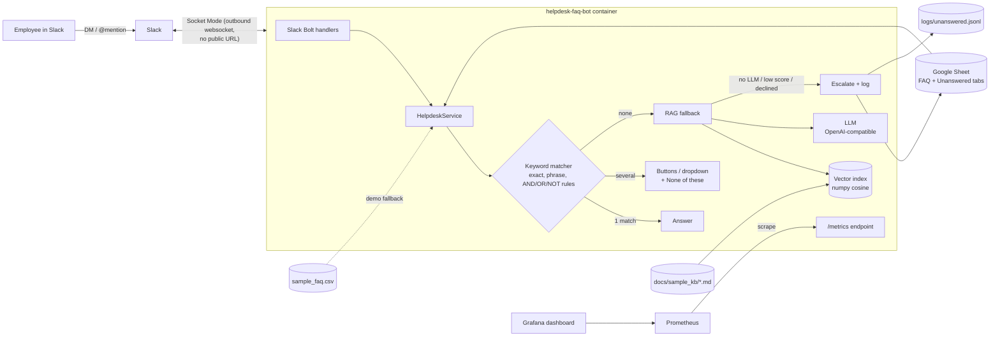

# helpdesk-faq-bot

**A Slack IT helpdesk bot that answers the boring questions instantly, uses AI only when it has to, and shows you what people are asking.**


Employees DM the bot (or @mention it in a channel) with questions like *"how do I connect to the VPN?"*.
The bot answers from an FAQ that non-technical staff maintain in a **Google Sheet**, using
**deterministic keyword rules** first (fast, free, predictable). Only when nothing matches does it fall back to
**RAG** (retrieval-augmented generation) over the FAQ and a Markdown knowledge base, answering with
**sources**. If it still can't help, it **escalates** and logs the question so IT can add a new FAQ.
Everything is instrumented with **Prometheus** and visualised in **Grafana**.

> This is a clean-room portfolio project with made-up sample data. It is inspired by an internal tool I
> built as a sysadmin, but contains no employer code, data, or configuration.

## Architecture



### How a question is answered

| Step | What happens | Cost / latency |
|---|---|---|
| 1. Exact | Question equals an FAQ question or alternate phrase (case/punctuation-insensitive) | ~1 ms, free |
| 2. Phrase | A full alternate phrase (3+ words) appears inside the question | ~1 ms, free |
| 3. Keyword rules | Boolean rule per row, e.g. `(wifi OR "wi-fi") AND (password OR connect) AND NOT guest` | ~1 ms, free |
| 3b. Ambiguous | Several rows match: Slack buttons (≤5) or a dropdown (>5), plus **None of these** | |
| 4. RAG | Embed question, retrieve top-k FAQ/KB chunks, LLM answers **only** from them, cites sources | 0.5–3 s, LLM tokens |
| 5. Escalate | No LLM configured, nothing relevant retrieved, LLM says `NO_ANSWER`, or LLM errors: log + tell the user IT will follow up (with related articles) | free |

## Features

- **Slack Bolt for Python, Socket Mode**: runs behind a firewall or NAT with no inbound ports or public URL.
- **Google Sheet as the CMS**: IT staff edit answers, alternate phrases, and rules in a spreadsheet; changes are picked up within `FAQ_CACHE_SECONDS` (no redeploy). Local **CSV fallback** for demos and tests.
- **Keyword rule language**: `AND` / `OR` / `NOT`, parentheses, `"quoted phrases"`, implicit AND, whole-word matching. Bad rules are reported by `check` and skipped instead of crashing the bot.
- **Clarification flow**: only the person who asked can pick; choices expire after 15 min; repeat clicks are ignored; `cancel`, `new question: ...`, and `escalate` commands.
- **RAG fallback with pluggable backends**:
  - Embeddings: offline hashing (default, zero downloads), `sentence-transformers` (local), or any OpenAI-compatible `/embeddings` API.
  - LLM: any OpenAI-compatible `/chat/completions` endpoint (OpenAI, Ollama, vLLM, LM Studio, LiteLLM gateway).
  - Guardrails: answer only from context, cite sources, refuse with `NO_ANSWER`, never ask for passwords.
  - **Degrades gracefully**: no LLM key means unmatched questions are escalated, never a crash.
- **Observability**: Prometheus counters and histograms (questions, matched vs unmatched, outcomes, RAG fallback results, escalations, latency, FAQ size, bad rules) and a provisioned Grafana dashboard.
- **Unanswered-question log**: JSONL file, plus an *Unanswered Questions* sheet tab when Sheets is configured. Review it weekly to grow the FAQ.
- **Production-shaped**: non-root Docker image, secrets via env/Secret Manager, CI (ruff + pytest + docker build + smoke test), Terraform for Cloud Run.

## Quick start (no Slack needed)

```bash
git clone https://github.com/<your-github-username>/helpdesk-faq-bot.git
cd helpdesk-faq-bot
python -m venv .venv && source .venv/bin/activate      # Windows: .venv\Scripts\activate
pip install -r requirements-dev.txt
export PYTHONPATH=src                                   # Windows PowerShell: $env:PYTHONPATH="src"

python -m helpdesk_faq_bot check                        # validate FAQ rows + rules
python -m helpdesk_faq_bot demo                         # answer sample questions
python -m helpdesk_faq_bot ask "my wifi keeps dropping"
python -m helpdesk_faq_bot match "connect the printer to wifi"   # which rows match, read-only
python -m helpdesk_faq_bot chat                         # interactive
pytest -q
```

Sample `demo` output:

```text
Q: how do i connect to the vpn from home
   [phrase] (0.7 ms)
   Open the VPN client, choose the *Primary* gateway, and sign in with your work email. ...

Q: how do I connect the printer to wifi
   [ambiguous] (0.7 ms)
   I found a few possible answers. Which one do you mean?
     1. How do I connect to the office Wi-Fi?
     2. How do I add the office printer?
     x. None of these

Q: my laptop fan is really loud and it's overheating
   [unanswered] (1.2 ms)
   Sorry, I don't have an answer for that yet. I've logged your question and escalated it to the IT team, who will follow up.
   In the meantime, these articles might help: Laptop overheating, fan noise, and battery health
```

### Try the RAG fallback

Free and local with [Ollama](https://ollama.com):

```bash
ollama pull llama3.2
export LLM_BASE_URL=http://localhost:11434/v1 LLM_MODEL=llama3.2
python -m helpdesk_faq_bot ask "my laptop fan is really loud and it's overheating"
```

Or with an API: `LLM_BASE_URL=https://api.openai.com/v1 LLM_API_KEY=sk-... LLM_MODEL=gpt-4o-mini`.

For better retrieval, install local semantic embeddings: `pip install -r requirements-rag.txt`, then set
`EMBEDDING_BACKEND=sentence-transformers` and `RAG_MIN_SCORE=0.35`.

Just checking the wiring? `python scripts/mock_llm.py` starts a fake OpenAI-compatible server that echoes the top retrieved chunk.

## Run in Slack

1. Use a **personal test workspace** (free at slack.com/get-started).
2. [api.slack.com/apps](https://api.slack.com/apps) → **Create New App → From a manifest** → paste [`slack/manifest.yaml`](slack/manifest.yaml).
3. **Install to Workspace**; copy the Bot token (`xoxb-…`).
4. **Basic Information → App-Level Tokens** → create one with `connections:write`; copy it (`xapp-…`).
5. `cp .env.example .env`, then fill in `SLACK_BOT_TOKEN` and `SLACK_APP_TOKEN`.
6. `python -m helpdesk_faq_bot slack`, then DM the bot or `/invite @helpdesk-bot` to a channel and mention it.

### Use a Google Sheet instead of the CSV

1. Create a sheet with a tab **FAQ** whose header row is `Category | Question | Answer | Alternate Phrases | Keyword Rules` (import `data/sample_faq.csv` to start), and a tab **Unanswered Questions** with `Date | Question | Status | Resolution | User`.
2. In a personal GCP project, enable the Sheets API, create a service account, and download a JSON key into `secrets/` (git-ignored).
3. Share the sheet with the service account email as **Editor**.
4. Set `GOOGLE_SHEET_ID` and `GOOGLE_APPLICATION_CREDENTIALS` in `.env`. On Cloud Run, no key file is needed: the attached service account is used.

## Observability: docker compose + Prometheus + Grafana

```bash
docker compose up --build                      # real Slack bot (needs .env)
BOT_MODE=simulate docker compose up --build    # no Slack: synthetic traffic for the dashboard
```

- Grafana: http://localhost:3000 (admin / admin). The **Helpdesk FAQ Bot** dashboard is provisioned automatically.
- Prometheus: http://localhost:9090 · Raw metrics: http://localhost:8000/metrics

| Metric | Type | Meaning |
|---|---|---|
| `helpdesk_questions_total{channel_type}` | counter | questions received (im / channel / cli) |
| `helpdesk_answers_total{outcome}` | counter | exact, phrase, keyword, ambiguous, rag, unanswered |
| `helpdesk_matched_total` / `helpdesk_unmatched_total` | counter | keyword matcher hit rate |
| `helpdesk_rag_fallback_total{result}` | counter | answered, no_llm, low_score, llm_declined, llm_error |
| `helpdesk_escalations_total{reason}` | counter | why questions reached a human |
| `helpdesk_answer_latency_seconds{path}` | histogram | keyword vs rag vs escalate latency |
| `helpdesk_faq_entries`, `helpdesk_faq_rule_errors` | gauge | FAQ health |


<!-- TODO: replace with a real screenshot after running docker compose -->

## Deploy to GCP (optional)

[`terraform/`](terraform/) deploys to **Cloud Run** with tokens in **Secret Manager**, a least-privilege
service account, and Artifact Registry. Socket Mode means the service needs **no public ingress**:
it keeps one always-on instance with an outbound websocket. See [`terraform/README.md`](terraform/README.md).

## Project layout

```text
src/helpdesk_faq_bot/
  matcher.py      keyword rule parser + 3-tier matcher
  faq_source.py   CSV / Google Sheets sources, TTL cache, unanswered log
  rag.py          chunking, embedders, vector index, OpenAI-compatible LLM client
  service.py      orchestration: match -> RAG -> escalate, metrics
  slack_app.py    Bolt handlers, buttons/dropdown, Socket Mode
  metrics.py      Prometheus metrics
  cli.py          demo / ask / chat / check / match / simulate / slack
data/sample_faq.csv        26 generic IT FAQs
docs/sample_kb/*.md        knowledge-base articles for RAG
monitoring/                Prometheus config + Grafana provisioning + dashboard JSON
slack/manifest.yaml        Slack app manifest
terraform/                 Cloud Run + Secret Manager starter
tests/                     pytest (matcher, RAG with stub embedder/LLM, Slack helpers)
```

## Roadmap

- [ ] Evaluate retrieval: a small labelled question set, tracking hit rate / MRR in **MLflow** for each embedding backend
- [ ] Persist pending choices in Redis/Firestore to allow more than one replica
- [ ] Deploy on **GKE** with a Helm chart + ServiceMonitor (Prometheus Operator)
- [ ] Ship metrics from Cloud Run via Google Managed Prometheus / OpenTelemetry
- [ ] Email/Slack notification to IT on escalation
- [ ] Feedback buttons (👍/👎) on RAG answers, exported as a metric and used for evals
- [ ] Swap the numpy index for FAISS/Chroma once the KB passes a few thousand chunks
- [ ] Ingest KB from Google Drive / Confluence on a schedule (Airflow or GitHub Actions)

## Credits

Built by **Paul Kosal** with AI pair programming: an AI coding assistant helped scaffold the code, tests, and
docs, which I reviewed, ran, and extended. The original idea and matching design come from a helpdesk bot I
built and run as a sysadmin. Sample FAQ and KB content are fictional.

## License

[MIT](LICENSE) © 2026 Paul Kosal
